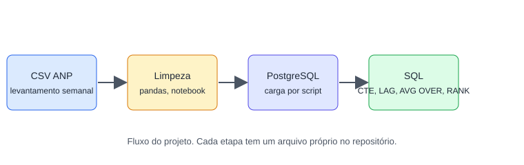
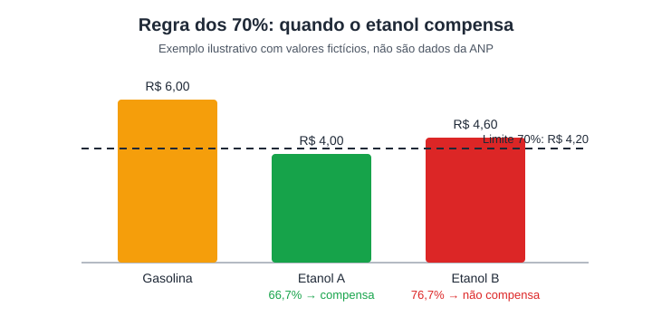

# combustiveis-sql-analytics

Análise de preços de gasolina, etanol e diesel no estado do Rio de Janeiro, em Python e SQL.

## Motivo do projeto

Este é um projeto de portfólio. O objetivo é mostrar SQL aplicado a dados reais, habilidade pedida em vagas de dados. A pergunta vem de uma dúvida prática: quando abastecer com etanol compensa no bolso.

A regra usada como critério é a dos 70%: o etanol compensa quando o preço por litro é até 70% do preço da gasolina.

O diagrama acima usa valores fictícios para mostrar a regra. Não são dados da ANP.

## Pergunta principal

Como o preço de gasolina, etanol e diesel varia por município e por semana, e em quais municípios o etanol compensa pela regra de 70% do preço da gasolina?

## Hipótese

Municípios do interior do Rio de Janeiro ficam abaixo do limite de 70% com menos frequência que municípios da Região Metropolitana. A hipótese assume que o preço do etanol segue o custo de transporte e a concorrência local.

**O que a refutaria:** se a fração de semanas com etanol até 70% da gasolina for igual ou maior no interior do que na Região Metropolitana, em uma comparação com dados do mesmo período, a hipótese é rejeitada.

**Resultado: refutada pelo critério acima, com diferença pequena.** A fração foi de 8,0% no interior e 7,4% na Região Metropolitana. A diferença é de 0,6 ponto percentual e não passou por teste estatístico. Ver Achados, item 4.

## Fontes e licença

Fonte: levantamento semanal de preços da ANP, série `dsan` de 2023 a 2025. URLs verificadas e status da licença em [docs/fontes.md](docs/fontes.md).

A licença de uso foi confirmada pelo dono do projeto em 2026-10-23. O agente não leu o texto dos termos. Para citar a licença exata, copie-a dos "Termos de uso do portal da ANP".

## Como reproduzir

1. Subir o PostgreSQL local: `docker compose up -d`
2. Criar o ambiente e instalar as versões fixadas: `python -m venv .venv` e `pip install -r requirements.txt`
3. Baixar os CSVs da ANP: `python scripts/baixar_anp.py`
4. Executar a limpeza: `notebooks/01_limpeza.ipynb`, do início ao fim
5. Carregar no banco: `python scripts/carga_postgres.py`
6. Rodar as queries em `sql/` na ordem numérica

## Como foi a limpeza

Tabela completa em [docs/decisoes_limpeza.md](docs/decisoes_limpeza.md).

| Etapa | Entrada | Saída | Descartadas |
|---|---:|---:|---:|
| UF = RJ | 2.608.591 | 214.065 | 2.394.526 |
| Produto (gasolina, etanol, diesel) | 214.065 | 147.189 | 66.876 |
| Valor sem vírgula decimal | 147.189 | 147.144 | 45 |
| Duplicata exata | 147.144 | 147.142 | 2 |
| Outlier de domínio (R$ 2 a 12) | 147.142 | 147.142 | 0 |

Base final: 147.142 coletas, 32 municípios, de 2023-01-02 a 2025-12-31.

## Achados

Os números vêm das queries em `sql/`, rodadas em PostgreSQL 16 sobre a base limpa.

**1. O etanol compensa em poucos casos.** Em 326 de 4.210 pares município-semana com os dois preços (7,7%), o etanol ficou até 70% da gasolina.
- *Recomendação:* não tratar a regra de 70% como sinal geral. Usar o município e a semana específicos antes de decidir.
- *Limite:* o dado não prova que a regra deve ser usada para decisão de abastecimento. O cálculo usa preço médio dos postos coletados, não o preço de um posto específico.

**2. A concentração é forte por município.** Itaperuna (38,2%), Teresópolis (31,6%) e São Francisco de Itabapoana (27,9%) têm mais semanas com etanol compensando. Treze municípios nunca chegaram a 70%, entre eles Volta Redonda, Macaé e Petrópolis.
- *Recomendação:* para análise de consumo local, olhar a tabela de município, não só a média do estado.
- *Limite:* alguns municípios têm menos semanas coletadas (Magé, 51 semanas com etanol e gasolina; Itaguaí, 75 com etanol). A comparação entre eles usa amostras menores.

**3. O ano pesa mais que o município.** A fração de semanas com etanol compensando foi de 4,6% em 2023, 16,9% em 2024 e 1,1% em 2025. A mudança de ano pesa mais que a diferença entre municípios.
- *Recomendação:* qualquer conclusão sobre a regra precisa separar o ano. Não agregar 2023–2025 sem olhar essa variação.
- *Limite:* não há causa identificada no dado. Mudanças de preço do etanol e da gasolina nesse período são externas a esta base.

**4. A hipótese do interior foi refutada, com diferença pequena.** Interior: 8,0% das semanas com etanol compensando. Região Metropolitana: 7,4%.
- *Recomendação:* não usar essa diferença como argumento. A direção oposta à prevista é pequena demais para afirmar algo.
- *Limite:* o agrupamento "Região Metropolitana" foi definido manualmente com 11 municípios. Não houve teste estatístico. O dado não prova que não existe diferença real entre as regiões.

**5. A variação semanal é pequena na maior parte das semanas.** Em 95% das variações semanais, o preço médio do etanol mudou até 3,45% em relação à semana anterior. Para a gasolina, o limite foi de 2,96%.
- *Recomendação:* médias móveis de 4 semanas (query 3) servem para acompanhar tendência sem reagir a cada coleta.
- *Limite:* a média é de postos coletados, sem ponderar pelo número de postos em cada município.

**6. Ranking de preço médio por município.** Para o etanol, Magé (R$ 4,02), Teresópolis (R$ 4,06) e Itaguaí (R$ 4,14) têm os menores preços médios. Para a gasolina, o mais barato é Teresópolis (R$ 5,38).
- *Recomendação:* usar o ranking como ponto de partida, não como decisão final, porque o número de coletas varia por município.
- *Limite:* o ranking usa média simples. Um município com poucos postos pode ter média distorcida.

## Limites

- Recorte: estado do Rio de Janeiro. Mudar o recorte depende de confirmação do dono do projeto.
- A pesquisa da ANP é uma amostra de postos. Ela não cobre todos os postos de cada município, e a amostra muda de semana para semana.
- Os achados são descritivos. Eles não provam causa para diferença de preço.
- Dados de 2026 não entraram na análise. Os nomes dos arquivos desse ano não seguem um padrão único.
- Diesel foi limpo e carregado, mas não entrou nas perguntas de achados acima.

## O que faria diferente

- Ponderar as médias pelo número de postos em cada município e semana, em vez de média simples.
- Definir a Região Metropolitana com a lista oficial do IBGE, em vez de uma lista feita à mão.
- Fazer um teste estatístico para a comparação entre regiões antes de falar em diferença.
- Incluir 2026 quando os nomes dos arquivos estiverem mapeados.
- Testar a regra de 70% no preço de cada posto, não só na média do município.
- Comparar o resultado com um segundo índice de preço, para não depender de uma única fonte.
